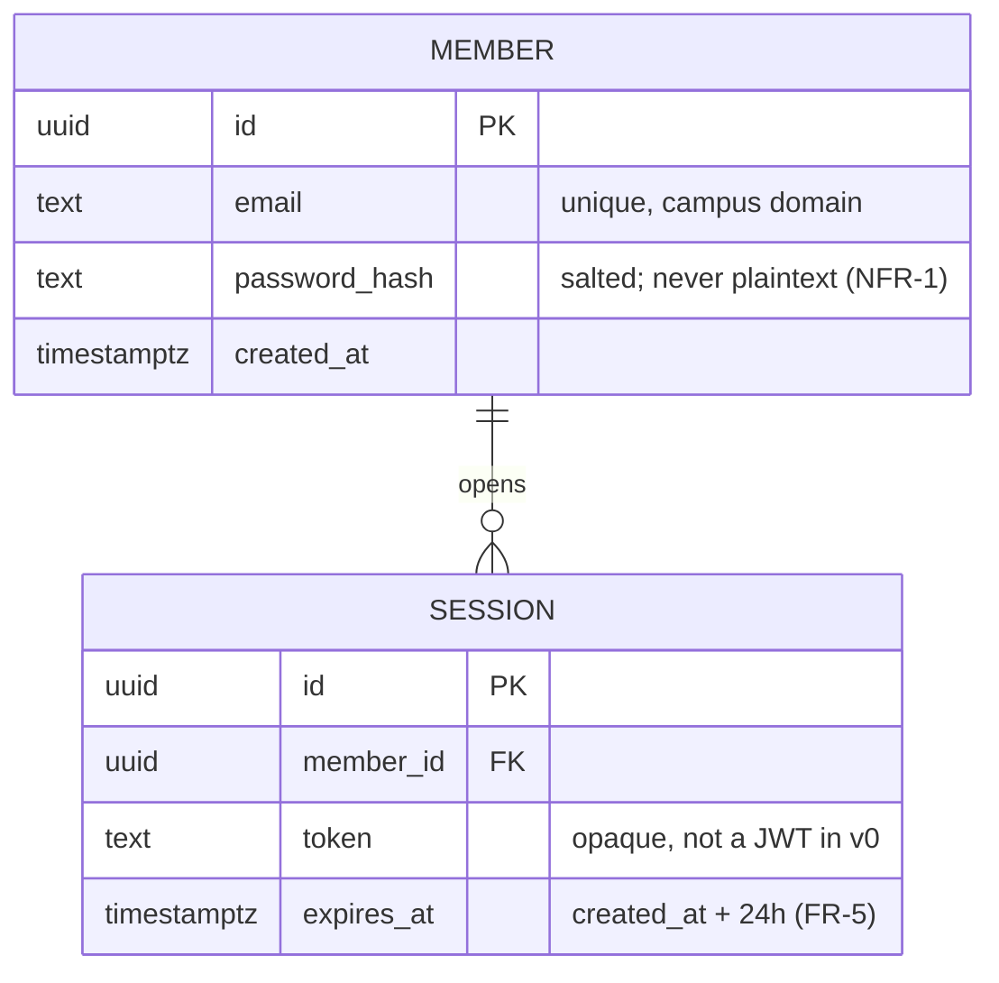

# Design — System Context Diagram  (../Diagrams/'System Context Diagram.png')

> Epic: #1 · Stories: #4
> Owner: 〈Homan Qiu〉 · Sprint: 2 · Status: draft
> Specification: [`../specs/example-spec.md`](../specs/example-spec.md)

*A worked example of a design document: it names its issues (gate G2),
carries real diagrams (gate G7), and every box and arrow corresponds to
something that exists or that the team has decided to build. Replace it with
your own — and see [`DIAGRAMS.md`](DIAGRAMS.md) for tools and conventions.*

## 1. System context

Who and what is outside our boundary, and what crosses it.

```mermaid
Inside our system:
	- ECS Game Engine: Handles entity-component-system management, rendering, audio, input processing, and asset management.
	- ECS Game Demo: Uses the engine's APIs to implement gameplay and demonstrate engine functionality.
```

*Figure 1 — System context. Solid lines exist in prototype v0; the dashed
line is a CPSC 491 intention, marked as such so nobody reads it as built.*

## 2. Components

| Component | Responsibility | Interface | Where |
|---|---|---|---|
Rendering System	Processes rendering requests and submits graphics commands	Rendering API → GPU	Engine source
Audio System	Handles sound playback and audio resource management	Audio API → Audio device	Engine source
Input System	Receives and processes player input events	Input polling and event callbacks	Engine source
Asset Manager	Loads and manages textures, models, shaders, and other resources	File loading and resource handles	Engine source
OS/Platform Layer	Provides access to operating system services and hardware interfaces	Platform APIs and hardware abstraction	Engine source

## 3. Data model



*Figure 2 — Entity-relationship model. One member has many sessions; a
session cannot exist without a member. Attribute notes cite the requirement
they satisfy, so a reviewer can check the design against the spec.*

## 4. Data flow (level 1)

```mermaid
1. Input events	Player input is received by the engine.
2. Processed input	Input events are made available to the ECS world.
3. API calls	The game demo sends gameplay instructions through engine APIs.
4. ECS data	Entity, component, and system data are processed.
5. Load resources	Asset Manager requests resources from external files.
6. Loaded assets	Textures, models, shaders, and other resources are returned.
7. Render data	ECS systems provide the data needed to render the scene.
```


## 5. Key decisions

| Decision | Options considered | Chosen | Why |
|---|---|---|---|
| Asset loading | rendering is performed by the game engine | Allow loading external textures from game demo | More safe for developers to process data|


## 6. What is NOT designed yet

- The specific stucture of the ECS game engine.
- How the game demo is going to operate.
