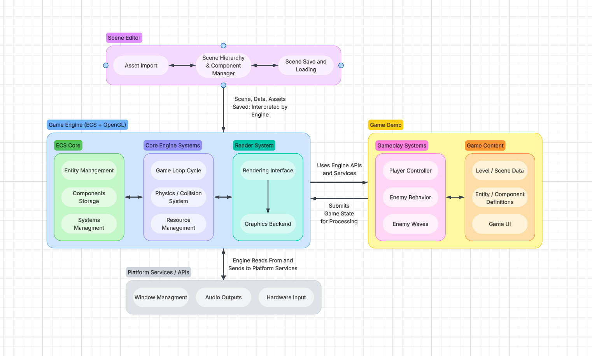

# Design — Game Engine and Game Demo System Architecture

> Epic: [#25](https://github.com/Isaiah714/CPSC490-G15-HIBBI-01/issues/25), [#24](https://github.com/Isaiah714/CPSC490-G15-HIBBI-01/issues/24) \
> Owner: Isaac Morrell · Sprint: 2 · Status: Draft \
> Source: [Lucidchart](https://lucid.app/lucidchart/70a10098-cd63-4b82-9980-bee08905d852/edit?viewport_loc=1492%2C35%2C2782%2C1820%2C0_0&invitationId=inv_8b9ad919-556b-4312-82a1-66fc80152ced')

## 1. Architecture Overview

The proposed project consists of two primary components: the Game Engine and the Game Demo, as well as an Editor application for the engine. These systems form a lightweight game engine framework to provide developers with the core foundation to develop games.

The Game Engine serves as the foundation of the project, providing the runtime systems responsible for managing game state, processing entities, handling input, and rendering the game world. Its architecture is centered around an Entity Component System (ECS) model, which separates entity identity, component data, and system behavior.

The Scene Editor provides development time functionality for creating and configuring game content. Allowing developers to import resources, create and modify objects, and arrange elements within a game world. Editor created scenes will be saved and can be loaded and interpreted by the Game Engine.

The Game Demo serves as an example application built using the framework. It demonstrates the engine's functionality through a game demo containing player interaction, enemies, and a functional gameplay loop. It will also provide a practical method of validating the engine's core capabilities.

## 2. High-Level Architecture Diagram

*Figure 1 - High Level architecture of proposed game engine framework. The diagram illustrates two primary project components, the game engine and game demo, as well as the scene editor component. As well as their internal subsystems and relationships between the editor, engine runtime, and game demo*

The architecture is organized around the Game Engine, which provides the shared functionality required by the other components. The Game Demo uses the engine's runtime services to execute gameplay, while the Scene Editor provides tools for creating and configuring content that can be loaded by the runtime.

The engine is divided into several major subsystems, each responsible for a specific area of functionality. These subsystems are designed to work together while maintaining separation between game-specific logic, core engine functionality, and development tools.

## 3. Components

| Component | Responsibility |
| --- | --- |
| ECS Core | Manages entities, components, and systems |
| Render System | Handles visual representation of the game world |
| Core Engine Systems | Runtime / game loop, physics systems, resource management |
| Platform Services / APIs | Handles platform and API related functions like input handling, window management, audio |
| Game Demo | Demonstrates Game Engine through playable application |
| Scene Editor | Provides development tools for creating and configuring game content and levels |
